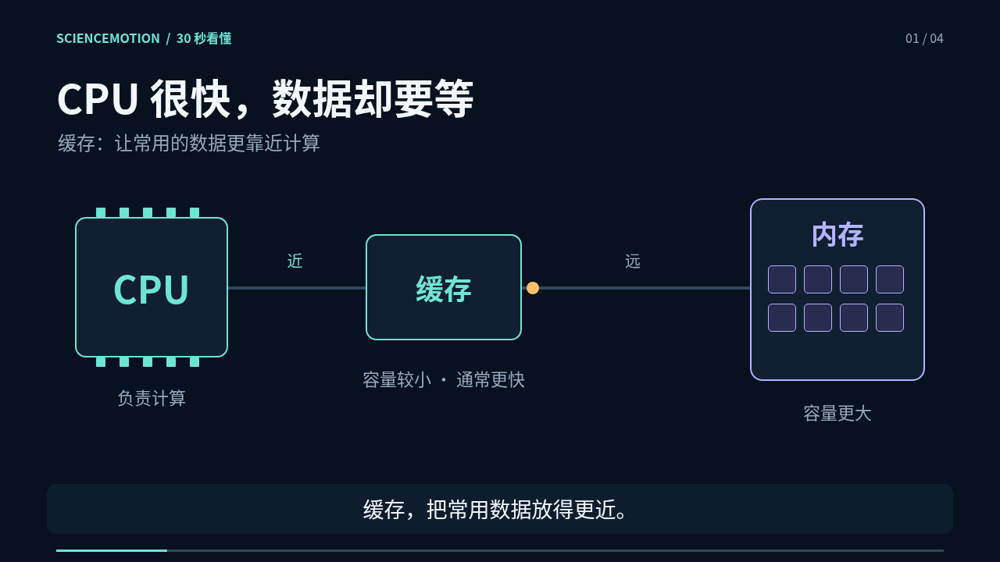

# 当前能力样片：CPU 为什么需要缓存？

[播放 / 打开视频](cpu-cache-30s.mp4) · [直接下载 MP4](https://raw.githubusercontent.com/xxbo/ScienceMotion-AI/main/docs/showcase/cpu-cache-30s.mp4)



30 秒，1280 × 720，30 fps，中文合成旁白与画面要点文字。这里保留一个不足 1 MB 的固定样片，作为效果评审基准。日常导出仍放在 `out/` 或 CI artifacts。

## 看什么

| 时间 | 画面与知识点 | 用到的现有能力 |
| --- | --- | --- |
| 0–6 秒 | CPU、缓存、内存与移动的数据点 | 文字、基础图形、SVG 路径、位置与透明度关键帧 |
| 6–14 秒 | 缓存命中和未命中的路径对比 | 多元素分层、定时移动、闪烁提示 |
| 14–22 秒 | 时间局部性与空间局部性 | 重复访问动画、数组示意与移动高亮 |
| 22–30 秒 | 命中率与平均延迟 | 数据驱动柱状图、公式、结论卡片 |

模型明确假设：每次查询缓存耗时 1，未命中额外耗时 10，因此平均延迟为 `1 + (1 − 命中率) × 10`。0%、50%、90%、99% 命中率对应 11、6、2、1.1。数字仅用于教学，非硬件实测。画面省略多级缓存、访存并行、预取和一致性等机制。

## 这段视频证明什么

画面由已有的公开 Host 工具创建：空项目 → 四个场景 → 137 个节点 / 38 条动画轨道 → 不可变快照 → 检查与预览 → 分镜 MP4。四个镜头使用同一个 `ProjectGraph` composition，未新增该题材专用的 TSX 或修改渲染引擎。按镜头导出使每次调用保持在现有工具的 30 秒超时范围内。

分镜、文案、布局与时间安排由本次助手会话设计，并固化为可复现的工具调用脚本。这是当前工具的创作能力展示，还不等于产品已经能从一句话需求独立完成策划、审美判断和修复。

音频通过 Edge TTS 和 FFmpeg 后期合成。通用 Project Graph 的音轨、混音和完整字幕系统仍未交付。屏幕下方是要点文字，不是逐字字幕。

## 检查证据

- 基础能力来自 main `d16a92e06ba88c8223b6c7a8bac62862975440e3`。本次增量增加样片、复现脚本和媒体校验，未增加渲染能力。
- `inspect.snapshot` 检查了 16 个明确时间点，没有报告结构/模型与声明图形边界问题。它没有检查全部 900 帧、浏览器文字布局、遮挡、音频或科学准确性。
- 助手检查了四个镜头的代表性 PNG，未发现明显文字裁切或遮挡；用户审美与可理解性评审仍待进行。
- 成片校验覆盖 900 帧完整解码、分辨率、帧率、H.264/AAC、非静音信号、明显黑场，以及音视频轨各 30 秒。
- 每段旁白先测时，再做小幅变速与按采样数补齐；拼接点严格对应 6 / 14 / 22 秒。这里没有宣称逐字对齐或人工听审完成。

固定文件的哈希、检查帧、工具调用数量与配音时长见 [evidence.json](evidence.json)。这不会关闭 P1.1 的两主题创作、恢复、真实 AI 发现/调用或人类视觉评审验收项。

## 复现

需要 Node.js 22、FFmpeg/ffprobe、Python 3，以及 Noto CJK 中文字体。运行目录为仓库根目录。

```bash
npm install
npx remotion browser ensure
python3 -m venv .venv
.venv/bin/pip install -r requirements-voice.txt
npm run render:showcase
.venv/bin/python scripts/finish-cache-showcase.py
python3 scripts/validate-showcase.py out/cache-showcase/cpu-cache-30s.mp4
```

`render:showcase` 生成项目 JSON、16 份检查报告、调用记录、四张预览和四个无声片段。后期脚本需要网络访问 Edge TTS；在 `out/cache-showcase/` 输出完整 MP4、无声版本与音频证据。缓存配音按文本、音色和语速校验，修改文案会重新生成。

CI 校验仓库中这一固定样片，并运行原有平台和生产渲染回归。在线 TTS 与整段样片重新制作由上述命令完成，不作为这次 CI 已经重复执行的项目。
